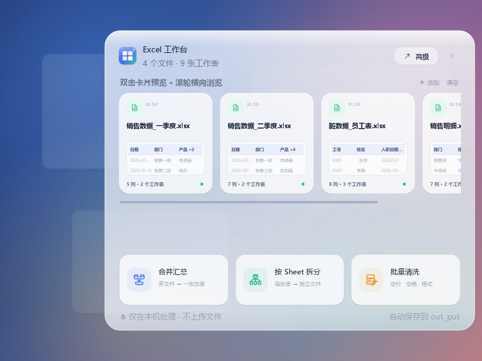
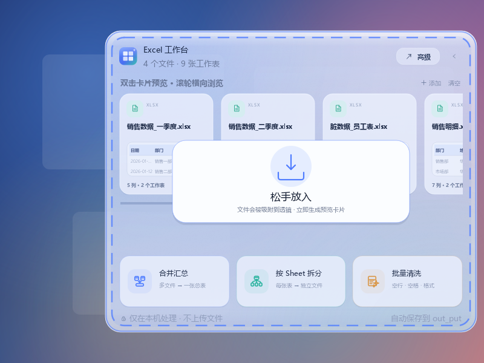
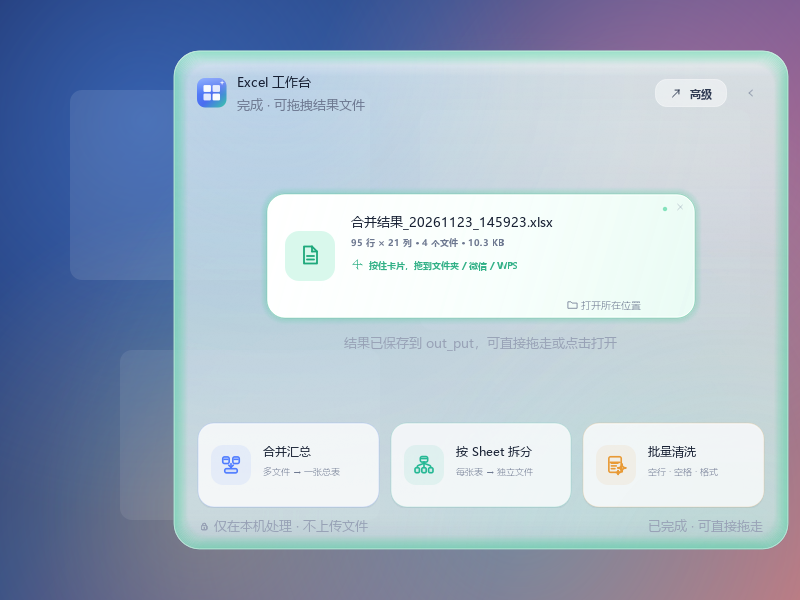
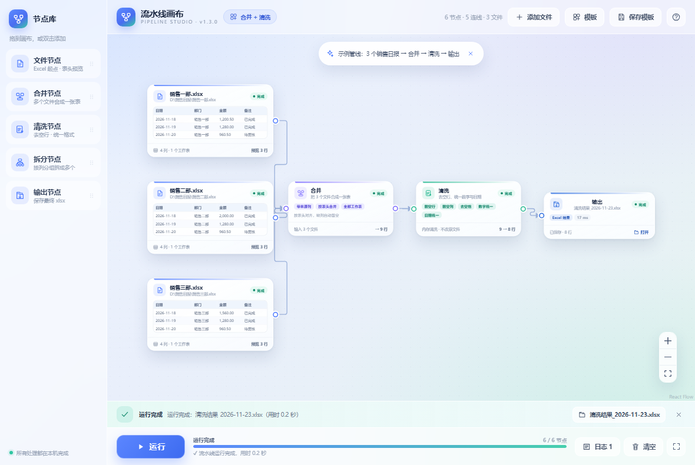
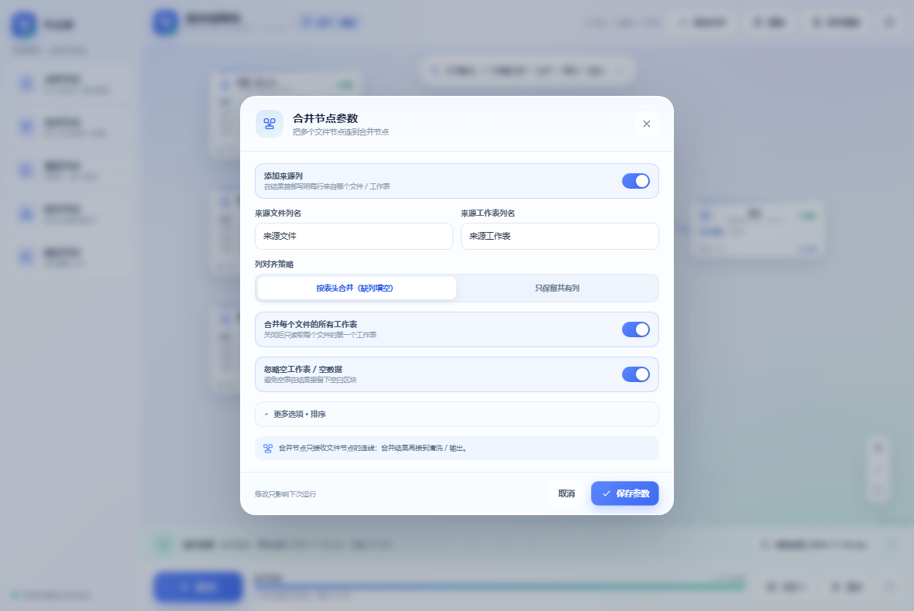
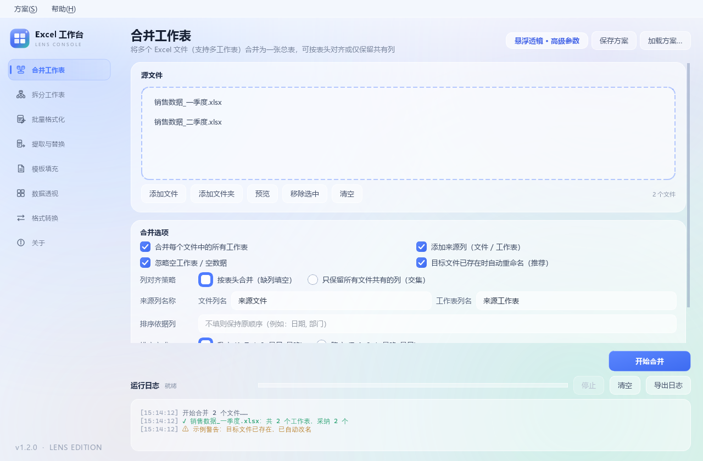
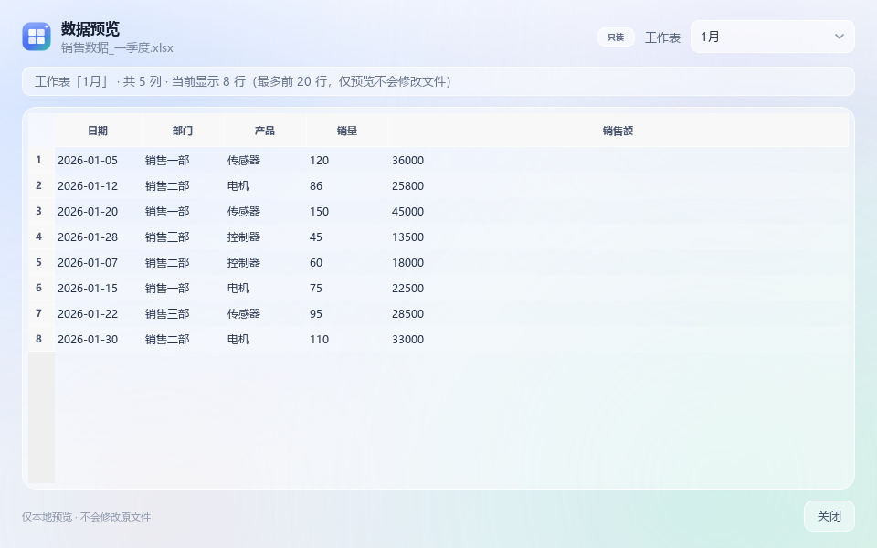

# Excel 工作台 (Excel Workbench)

一个基于 PyQt5 的桌面 Excel 批量处理工具。v1.2 重构为**悬浮透镜**交互：程序启动后不再打开大窗口，只在桌面留下一枚半透明毛玻璃小标签（默认为右侧中间，可拖动并记住位置），悬停即可展开。v1.3 新增**流水线画布**：把 Excel 拖进画布变成节点，连线编排合并 / 清洗 / 拆分 / 输出，一键跑完整条管线。

> 第一次使用？请先阅读已更新到 v1.3 的 **[详细使用指南](使用指南.md)**；仓库内的 **[PDF 版](使用指南.pdf)** 是上一版界面，专业工作台章节仍可参考。绿色版建议解压到**不含中文和空格**的纯英文路径（例如 `D:\ExcelWorkbench`）后再双击 `ExcelWorkbench.exe`。



## 交互

1. **平时**：一条 44×154 的半透明圆角标签，小字「Excel工作台」+ 图标，带 0.78 窗口透明度，几乎隐形。**按住标签顶部（Logo 与小圆点区域）可拖到桌面任意位置**，松开后自动记住；单击标签也能展开。标签在屏幕右半边时向左展开，在左半边时向右展开，面板会自动避开屏幕边缘。
2. **悬停**：平滑展开成 616×500 的毛玻璃面板。展开时采样面板背后的桌面并做强模糊，随壁纸颜色轻微混色。
3. **拖入 Excel**：把文件 / 文件夹直接拖到透镜上，自动吸附展开，逐个生成并排的微缩预览卡片，显示每个文件的表头与首行数据。
4. **选择动作**：透镜下方只保留三个大图标按钮——**合并汇总**、**按 Sheet 拆分**、**批量清洗**。
5. **合并汇总**：弹出一行极简开关（是否带来源列、目标文件冲突时是否自动重命名），点「开始合并」即执行。
6. **按 Sheet 拆分**：每个工作簿里的每张 Sheet 输出为一个独立 `.xlsx`。
7. **批量清洗**：清理空行空列、首尾空格，统一数字与日期格式，清除超链接 / 批注，另存为清洗后的副本。
8. **执行反馈**：柔和环形进度条 + 实时状态文字；完成后整圈淡绿色光晕，弹出**发光结果卡片**。
9. **结果拖出**：按住结果卡片，直接拖到文件夹、微信、WPS 等任意支持文件拖放的位置；也可以点击卡片打开，或点「打开所在位置」。
10. **高级**：右上角「高级」进入原来的专业工作台，自动带入当前文件，继续使用列对齐、文件名模板、单列绑定清洗、提取替换、模板填充、数据透视、CSV 转换等全部细粒度参数。





## 流水线画布（v1.3 新增）

高级工作台新增「流水线画布」Tab，用 React Flow 做拖拽画布，用 QWebEngineView + QWebChannel 与 Python 通信：

1. **拖入文件**：把 Excel 文件或文件夹拖进画布，每个文件变成独立节点卡片，自动读取表头与前 3 行预览。
2. **连线编排**：多个文件节点 → 合并节点 → 清洗节点 → 输出节点；也可以直接接拆分节点，按列拆成多个文件。
3. **双击改参数**：合并是否带来源列 / 列对齐策略 / 是否合并全部工作表；清洗删空行、去空格、数字与日期统一、去重；拆分按哪一列；输出文件名与目录。
4. **点运行**：数据沿节点管线流动，节点卡片实时显示处理行数、文件数和耗时，底部进度条与可展开日志同步更新。
5. **保存模板**：编排好的流程可保存为模板（内置「一键合并」「合并 + 清洗」）；下次载入模板，把新 Excel 拖到空文件卡片上就能一键跑。
6. **逻辑复用**：前端只负责拖拽与展示，合并 / 清洗 / 拆分 / 输出全部调用原有 Python 函数，不碰 pandas 处理逻辑。





## 统一的界面风格

高级工作台、数据预览对话框也延续悬浮透镜的浅色毛玻璃视觉：柔光渐变背景、半透明白玻璃卡片、靛蓝渐变主按钮、薄荷绿点缀与统一的圆角/字体。只从透镜点「高级」进入时，不会突然跳回旧的纯白扁平界面。





## 核心能力（保留）

| 模块 | 说明 |
| --- | --- |
| 流水线画布 | 拖拽节点编排「文件 → 合并 → 清洗 / 拆分 → 输出」，实时显示每个节点的处理数量，可保存为模板复用 |
| 合并工作表 | 多文件 / 多工作表合并；支持按表头对齐（缺列填空）或只保留共有列，来源列名称可自定义 |
| 拆分工作表 | 按指定列分组；文件名模板可自定义（如 `{分组列值}_数据.xlsx`），可过滤空分组；透镜快捷入口按 Sheet 拆分 |
| 批量格式化 | 原子清洗引擎：全局规则 + 单列绑定（手机号/金额/日期），自动套用数字格式与对齐方式 |
| 提取与替换 | 批量提取指定列；支持导入 Excel 对照表逐行批量替换，可选正则模式（默认关闭） |
| 模板填充 | 一份数据源 + 一份 xlsx 模板，按 `{{姓名}}` 等标记循环生成 N 份独立报表 |
| 数据透视 | 可视化选择行、列、值和聚合方式（求和 / 计数 / 平均值），一键生成透视表 |
| 格式转换 | CSV ↔ Excel 互转（CSV 可选 UTF-8 / GBK 编码，国内 GBK CSV 不再乱码） |

## 安装与运行

```bash
pip install -r requirements.txt
python main.py
```

启动后请把鼠标移到默认标签的**下半部分**（首次在屏幕右侧中间），悬停约 0.2 秒即可展开。也可以从系统托盘菜单选择「展开透镜」；按住标签顶部可拖到任意位置。

如果更习惯原来的完整界面，可以显式启动工作台：

```bash
python main.py --workbench
```

## 输出与安全

- 所有快捷操作的结果自动保存到项目根目录的 `out_put/`：合并为 `合并结果_时间戳.xlsx`（单文件，可直接拖到微信 / WPS），拆分 / 清洗为 `拆分结果_时间戳/`、`清洗结果_时间戳/`（文件夹，可拖到资源管理器）。
- 原始文件只读，不会被修改。
- 全部处理在本机完成，**不上传任何表格文件**。
- 拖入时只接受 `.xlsx / .xls / .xlsm`；CSV 互转请使用高级工作台的「格式转换」页。
- 输出文件被 Excel / WPS 占用时，会给出中文提示；合并的「冲突重命名」开关可自动避让。
- 失败信息会直接显示在透镜里，完整技术细节写入 `logs/error.log`。

## 打包 Windows 单文件 exe

项目提供 Nuitka 打包脚本，生成带图标、版本信息和单文件 exe 的发布压缩包：

```powershell
powershell -ExecutionPolicy Bypass -File packaging\build_nuitka.ps1
```

输出：

```text
dist/ExcelWorkbench_v1.3.0.zip
```

压缩包只包含 `ExcelWorkbench.exe` 和说明文档，不包含源码、测试数据或 `config` / `logs` / `out_put`。程序首次运行会在 exe 旁自动创建这些目录。详见 [打包说明](packaging/README.md)。

## 项目结构

```text
app/
  core/            纯业务：合并、拆分、清洗、预览、流水线编排、错误翻译
  workers/         后台任务线程（QThread，含流水线执行线程）
  ui/
    lens/          悬浮透镜：毛玻璃、图标、卡片、动效、快捷任务
    pages/         高级工作台功能页（含「流水线画布」）
    widgets/       文件列表、预览、日志、输出保护等通用组件
  resources/       样式、图标、构建后的流水线静态页面
pipeline/          React Flow 前端源码（Vite，构建产物写入 app/resources/pipeline）
main.py            入口：默认只启动悬浮透镜
```

### 重新构建流水线画布前端

仓库已经包含构建好的静态资源，普通使用无需 Node。修改 `pipeline/src` 后重新构建：

```powershell
cd pipeline
npm install
npm run build
```

构建产物会写入 `app/resources/pipeline`，由 QWebEngineView 以本地文件加载，不需要启动任何后端服务。

## 设计说明

- **毛玻璃**：展开前抓取面板背后的桌面区域，用 numpy 做盒式模糊、提亮和轻微加饱和，再叠加白色玻璃渐变、蓝绿环境光和细颗粒噪点；屏幕抓取失败时自动退回内置柔和渐变。
- **无边框悬浮窗**：`FramelessWindowHint | WindowStaysOnTopHint | Tool | WindowDoesNotAcceptFocus`，不抢焦点、不进任务栏；收起态窗口透明度 0.78，悬停时提升到 0.97 并展开。
- **可拖动停靠**：标签顶部 54px 是专用拖动区，悬停此处不会展开，按住可移动；位置写入 `config/lens_state.json`（绿色版随身携带），展开方向根据标签所处屏幕左右侧自动选择。
- **拖拽**：主窗口接收 `dragEnter / drop`，文件卡片在后台线程读取表头，不阻塞界面；结果卡片用标准 `QDrag + QMimeData(QUrl)` 输出，兼容资源管理器、微信、WPS 等。
- **兼容性**：Python 3.9+ / PyQt5 5.15 / pandas 2+；Windows 10/11 为主要目标平台。
